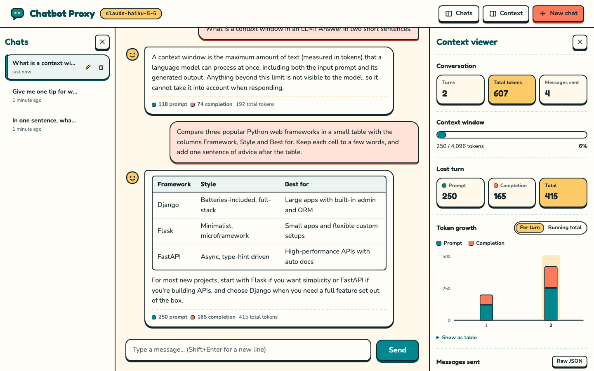

# Chatbot Proxy

A small chat app where the browser talks only to a **FastAPI backend**, and the backend talks to an LLM through any **OpenAI-compatible API**: OpenAI, OpenRouter, Groq, or a local server such as Ollama or LM Studio. The frontend is plain HTML, CSS and JavaScript. Replies are rendered as Markdown, and a **context viewer** shows exactly what is sent to the model and how many tokens come back.



- The API key stays in the backend. The browser never sees it.
- You switch providers by editing `.env`. No code changes.
- Replies stream token by token, you can attach images for vision models, and conversations are saved in SQLite.
- The full specification is in [docs/specs.md](docs/specs.md).

## Requirements

- **Docker** with Docker Compose, **or**
- **Python 3.11+** to run it locally without Docker.

## Quick start (Docker)

```bash
cp .env.example .env      # then edit .env: set LLM_BASE_URL, LLM_MODEL and (hosted providers only) LLM_API_KEY
docker compose up --build
```

Open **http://localhost:6661**. The backend runs on http://localhost:6662 (API docs at http://localhost:6662/docs).

## Provider presets

Set these values in `.env`:

| Provider   | `LLM_BASE_URL`                   | `LLM_API_KEY`        | `LLM_MODEL` (example)           |
| ---------- | -------------------------------- | -------------------- | ------------------------------- |
| OpenAI     | `https://api.openai.com/v1`      | your `sk-...` key    | `gpt-4o-mini`                   |
| OpenRouter | `https://openrouter.ai/api/v1`   | your `sk-or-...` key | `openai/gpt-4o-mini`            |
| Groq       | `https://api.groq.com/openai/v1` | your `gsk_...` key   | `llama-3.1-8b-instant`          |
| Ollama     | `http://localhost:11434/v1`      | not needed           | `llama3.2`                      |
| LM Studio  | `http://localhost:1234/v1`       | not needed           | the model id shown in LM Studio |

> **Local models with Docker.** Inside the backend container, `localhost` means the container itself, not your machine. When the backend runs in Docker and the model runs on your machine, use `host.docker.internal` instead:
>
> ```dotenv
> LLM_BASE_URL=http://host.docker.internal:11434/v1   # Ollama
> LLM_BASE_URL=http://host.docker.internal:1234/v1    # LM Studio
> ```
>
> This works on macOS, Windows and Linux (Compose adds the `host-gateway` mapping).

Also set `LLM_CONTEXT_WINDOW` to the model's context size so the context-size warning is accurate. For Ollama the effective window is the `num_ctx` it runs with (often 4096 by default), not the model's maximum.

## Running locally (no Docker)

Both modes read the same `.env` at the project root.

**Backend** (terminal 1):

```bash
cd backend
python3 -m venv .venv
source .venv/bin/activate          # Windows: .venv\Scripts\activate
pip install -r requirements.txt
uvicorn app.main:app --port 6662 --reload
```

**Frontend** (terminal 2, from the project root):

```bash
python3 -m http.server 6661 -d frontend
```

Open http://localhost:6661.

**Tests:**

```bash
cd backend
pip install -r requirements-dev.txt
pytest
```

The tests mock the LLM, so they need no API key or running model.

## Configuration

Every variable is documented in [.env.example](.env.example).

| Variable              | Default                    | Purpose                                                                                                                                         |
| --------------------- | -------------------------- | ----------------------------------------------------------------------------------------------------------------------------------------------- |
| `LLM_BASE_URL`        | **required**               | Base URL of the OpenAI-compatible API                                                                                                           |
| `LLM_API_KEY`         | empty                      | API key for hosted providers. Leave unset for local servers (Ollama, LM Studio)                                                                 |
| `LLM_MODEL`           | **required**               | Model name sent with every request                                                                                                              |
| `LLM_SUPPORTS_VISION` | `false`                    | Turns on image attachments (Stage 3)                                                                                                            |
| `LLM_SYSTEM_PROMPT`   | built-in default           | Replaces the default system prompt. Use `"line one\nline two"` for several lines                                                                |
| `LLM_TEMPERATURE`     | _(provider default)_       | Sampling temperature. Left out of the request when empty. Newer Claude models reject any value, so keep it empty for them                       |
| `LLM_TIMEOUT_SECONDS` | `120`                      | How long to wait for the model (when streaming: for each next chunk)                                                                            |
| `LLM_CONTEXT_WINDOW`  | _(off)_                    | Model context size in tokens, used only for the warning                                                                                         |
| `BACKEND_PORT`        | `6662`                     | Host port for the backend in Docker. If you change it, also edit `frontend/config.js`                                                           |
| `FRONTEND_PORT`       | `6661`                     | Host port for the frontend in Docker. If you change it, also edit `CORS_ORIGINS`                                                                |
| `CORS_ORIGINS`        | `http://localhost:6661`    | Comma-separated browser origins allowed to call the backend. `*` is refused                                                                     |
| `MAX_IMAGE_MB`        | `5`                        | Largest image upload (Stage 3)                                                                                                                  |
| `DATABASE_URL`        | `sqlite:///./data/chat.db` | Where conversations are saved (Stage 4). Relative to the backend's working directory: `backend/data/` locally, the `chat-data` volume in Docker |

If a required value is missing, the backend refuses to start and names the missing variable. Restart the backend after editing `.env`.

The default system prompt asks the model to answer in Markdown, since the chat renders it. The context viewer always shows the system prompt that is active as its first card.

## Streaming

Replies stream token by token: the backend calls the model with `"stream": true` and relays each chunk to the browser as a Server-Sent Event the moment it arrives (`POST /api/chat/stream`).

- While a reply streams, **Send** turns into **Stop**. Stop cancels the browser request, and the backend closes the request to the model so it stops generating (and stops spending tokens). The text that already arrived stays in the chat and in the history.
- Token usage arrives at the end of the stream, so a stopped reply has no usage.
- If a provider rejects the `stream_options` parameter used to ask for usage, the backend retries without it and the viewer shows "usage not reported".
- The non-streaming endpoint `POST /api/chat` still works. To use it from the UI, set `STREAMING = false` in `frontend/config.js`.

## Images (vision)

If the model can read images, set `LLM_SUPPORTS_VISION=true` in `.env` and restart the backend. A 📎 button then appears next to the input. You can also drag images onto the chat or paste them into the input.

- PNG, JPEG, WebP and GIF are accepted, up to `MAX_IMAGE_MB` each and 4 per message.
- Large images are shrunk in the browser (longest side 1568 px) before sending, which keeps payloads and token costs down.
- The backend checks the type and size of every image again, and refuses images when vision is off.
- In the context viewer, image data is shown as a placeholder such as `[image/png · 182 KB]` with a small thumbnail. A picture icon marks the turns that carried an image, so you can see how many prompt tokens it added.

There is no reliable way to detect whether a model supports vision, so the setting is manual. Vision models include `gpt-4o-mini` on OpenAI and `llava` or `llama3.2-vision` on Ollama.

## Chat history

Conversations are saved in SQLite and listed in the **Chats** sidebar, newest first.

- A conversation is created when you send its first message, and its title comes from that message. Click the pencil to rename it, or the bin to delete it with its images.
- The open conversation is in the URL (`#/c/<id>`), so reloading the page reopens it.
- Each request uses the `LLM_MODEL` and system prompt configured **now**, so an old conversation continues with whatever model you switch to.
- A stopped reply is saved with the text that arrived. A failed reply is not saved: the message is marked **Not sent**, and **Retry** sends it again.
- Data lives in `backend/data/` when run locally and in the `chat-data` Docker volume otherwise (`docker compose down -v` deletes it).
- There are no logins yet, but every conversation belongs to an account (a default `local` one for now), so authentication can be added later without changing the database.

To go back to the in-memory chat of Stages 1–3, set `HISTORY = false` in `frontend/config.js`.

## A tour of the context viewer

Click **Context** in the header to show or hide it (on phones it slides over the chat).

- **Conversation**: number of turns, total tokens used so far, and how many messages were in the last request.
- **Context window**: the last turn's prompt tokens against `LLM_CONTEXT_WINDOW`. At 80% a yellow warning appears, and at 100% a red one. Nothing is trimmed automatically: the whole history is sent on every turn.
- **Last turn**: prompt, completion and total tokens, as reported by the provider. If the provider does not report usage, the viewer says so. Token counts are never estimated.
- **Token growth**: two views of the same data. **Per turn** shows one stacked bar per turn (prompt in teal, completion in coral), so you can see the prompt grow as the history gets longer. **Running total** shows a line of the total tokens spent so far. Hover a bar or point for exact numbers, or open **Show as table**.
- **Messages sent**: the exact `messages` array the model received, one card per message (system in teal, user in coral, assistant in yellow). **Raw JSON** shows the full request payload, including the model and, when set, the temperature. With chat history, the backend builds this payload from the database, and it shows up after you send a message.

## Troubleshooting

| Symptom                                                                      | Fix                                                                                                                                                                                                                              |
| ---------------------------------------------------------------------------- | -------------------------------------------------------------------------------------------------------------------------------------------------------------------------------------------------------------------------------- |
| "The model provider rejected the API key"                                    | `LLM_API_KEY` is wrong or expired. Fix it in `.env` and restart the backend                                                                                                                                                      |
| "The model provider returned 404 for model …"                                | `LLM_MODEL` does not exist for this provider (for Ollama, run `ollama list`), or `LLM_BASE_URL` is missing the `/v1` path                                                                                                        |
| "Could not reach the backend at http://localhost:6662"                       | The backend is not running, or the browser was blocked by CORS. Add the exact page origin (e.g. `http://127.0.0.1:6661`) to `CORS_ORIGINS` and restart                                                                           |
| "Could not connect to the model server" with Docker and a local model        | Use `host.docker.internal` instead of `localhost` in `LLM_BASE_URL` (see above). For Ollama on Linux, also make it listen on all interfaces: `OLLAMA_HOST=0.0.0.0 ollama serve`                                                  |
| "The model did not answer within … seconds"                                  | Large local models can be slow, especially on the first request while they load. Raise `LLM_TIMEOUT_SECONDS`                                                                                                                     |
| Backend exits with "configuration is invalid"                                | A required variable is missing from `.env`. The message lists which one                                                                                                                                                          |
| Replies appear all at once instead of streaming                              | A proxy between the browser and the backend is buffering the response. The backend already sends `Cache-Control: no-cache` and `X-Accel-Buffering: no`; configure any other proxy to pass `text/event-stream` through unbuffered |
| No 📎 button                                                                 | `LLM_SUPPORTS_VISION` is not `true`, or the backend was not restarted after changing it                                                                                                                                          |
| "Image attachments are turned off for this model"                            | The backend has `LLM_SUPPORTS_VISION=false`. Turn it on only if the model supports vision                                                                                                                                        |
| An image fails with a provider error, or the model says it cannot see images | The model is not vision-capable. Set `LLM_SUPPORTS_VISION=false` or switch to a vision model                                                                                                                                     |
| "An attached image is larger than the … MB limit"                            | Raise `MAX_IMAGE_MB`, or use a smaller image                                                                                                                                                                                     |
| Saved chats disappeared after `docker compose down -v`                       | `-v` deletes the `chat-data` volume. Use `docker compose down` (without `-v`) to keep them                                                                                                                                       |

## Project layout

```
backend/    FastAPI proxy (app/, app/db/), tests, Dockerfile
frontend/   index.html, config.js, css/, js/, vendor/ (marked, DOMPurify, fonts)
docs/       specification and notes
data/       created at runtime: SQLite database and uploaded images (gitignored)
```

## Stages

| Stage                                 | Status  |
| ------------------------------------- | ------- |
| 1. Baseline: full reply, no streaming | ✅ Done |
| 2. Streaming over Server-Sent Events  | ✅ Done |
| 3. Vision: image attachments          | ✅ Done |
| 4. Chat history in SQLite             | ✅ Done |

## Third-party code

`frontend/vendor/` contains [marked](https://github.com/markedjs/marked) (MIT), [DOMPurify](https://github.com/cure53/DOMPurify) (Apache-2.0 / MPL-2.0) and the Fredoka, Nunito and JetBrains Mono fonts (SIL Open Font License). Their licenses are stored next to the files.
